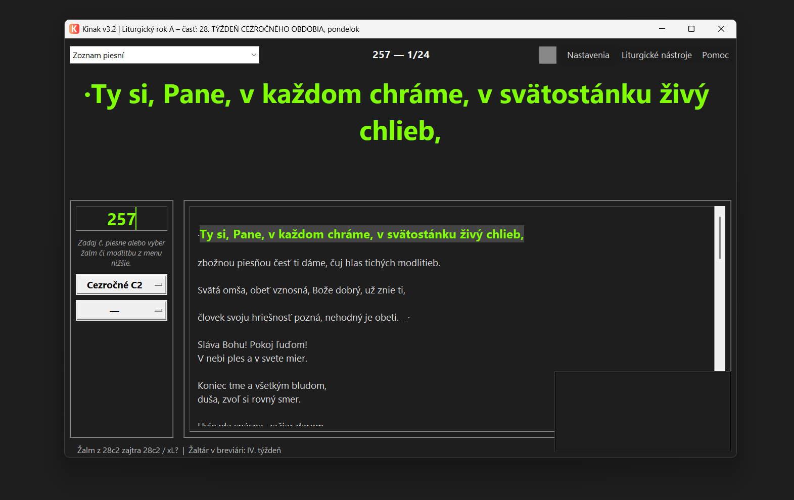

# Kinak

**Liturgický projekčný program pre farnosti na Slovensku – zdarma.**


🌐 [kinak.sk](https://kinak.sk/) · ⬇️ [Stiahnuť najnovšie vydanie](https://github.com/kinakprojekcia/Kinak/releases/latest)

Kinak je projekčný softvér na vizuálne sprevádzanie liturgie: premieta texty
piesní, modlitieb, čítaní a žalmov, aby sa veriaci mohli ľahšie zapojiť do
slávenia. Počas svätej omše beží vo všetkých kostoloch v Kremnici a vznikol
ako dobrovoľnícky projekt pre našu farnosť.



## Prečo Kinak

Premietač počas svätej omše často žongluje s Wordom, mobilom, viacerými
stránkami s čítaniami, knižkou žalmov a lístočkom s poznámkou. Je sviatok?
Má prednosť slávnosť? Rok A, B alebo C? Párny či nepárny rok?

Kinak to vypočíta automaticky a offline, takže premietač má všetko pripravené
na dva kliky. Môže tak konečne prežívať svätú omšu, nielen premietať.

## Funkcie

- **Premietanie** na druhý monitor alebo projektor (farby, veľkosť, prelínanie)
- **Piesne:** rýchle vyhľadávanie podľa čísla alebo názvu, vlastná knižnica,
  databáza JKS, mládežnícke piesne a piesne Večeradla
- **Liturgický kalendár pre Slovensko:** automatický výpočet liturgického dňa,
  Veľkonočnej nedele (Meeus-Jones-Butcher), liturgických období, týždňa
  žaltára I–IV, liturgického roka A/B/C a cyklu I/II
- **Presuny slávení** pri kolízii s významnejším slávením (Zvestovanie,
  sv. Jozef, Narodenie Jána Krstiteľa a i.)
- **Žalmy:** v stavovom riadku zobrazí skratku žalmu podla liturgického dňa a aktuálny týždeň žaltára v breviári. Odporúčané piesne JKS priradí podľa zvoleného žalmu (prepojenie s oknom Slávenia a Direktóriom)
- **Čítania a vešpery:** sťahovanie na daný deň (offline cache)
- **Funguje offline** po prvom stiahnutí

## Inštalácia (Windows)

1. Stiahnite si ZIP z [Releases](https://github.com/kinakprojekcia/Kinak/releases/latest) a rozbaľte ho.
2. Vedľa `Kinak.exe` musí byť priečinok `piesne/`:
   ```
  " ├── Kinak.exe\n"
  " └── piesne/\n"
  "               ├── Mládež/\n"
  "               ├── Večeradlo/\n"
  "               ├── 001.txt\n"
  "               ├── 002.txt\n"
  "               ├── 003.txt\n"
  "               └──  .  .  .\n\n" 
   ```
   Priečinok môžete ľubovoľne premenovať (napr. `Kinak_Projekcia`), ak zostane
   zachovaná táto štruktúra.
3. Spustite program a v menu **Pomoc → Rýchly sprievodca** postupujte podľa pokynov.
4. V **Nastavenia → Umiestnenie súborov** ešte raz skontrolujte nastavenie cesty k priečinku `piesne`
   (napr. `Kinak_Projekcia/piesne`).

## Liturgický kalendár – špecifikácia

Výpočty sa riadia smernicami pre Rímskokatolícku cirkev na Slovensku, nie
americkým modelom.

- **Krajina / provincia:** Slovensko (SK)
- **Kalendár:** všeobecný rímsky + vlastné slávenia slovenskej provincie
  (sv. Cyril a Metod 5. 7., Sedembolestná Panna Mária 15. 9. a i.)
- **Smernice:** Všeobecné normy o liturgickom roku a o kalendári + Direktórium KBS

**Kľúčový rozdiel oproti US modelu:** Zjavenie Pána je na Slovensku pevne
6. januára (prikázaný sviatok, štátny sviatok) a nepresúva sa na nedeľu.
Preto je Krst Krista Pána v nedeľu PO 6. 1., aj keď je 6. 1. nedeľa
(napr. 13. 1. 2019, 13. 1. 2030).

## Zdroje dát a licencia

- Čítania: [lc.kbs.sk](https://lc.kbs.sk/) (Konferencia biskupov Slovenska)
- Vešpery: [breviar.kbs.sk](https://breviar.kbs.sk/)
- Mládežnícke piesne: [mladeznickyspevnik.sk](http://www.mladeznickyspevnik.sk)

Obsah čítaní a vešpier nie je súčasťou programu. Sťahuje sa na požiadanie pre
osobnú potrebu farnosti a nespadá pod licenciu programu.

Program je pod [MIT License](LICENSE), © 2026 Kinak – Kremnica. Môžete ho
zdarma používať, upravovať a šíriť, aj na komerčné účely, pod podmienkou
zachovania informácie o autorovi a licencii.

## Kontakt a podpora

Chyby a nápady nahlasujte cez [Issues](https://github.com/kinakprojekcia/Kinak/issues).

Dobrovoľnícky projekt farnosti Kremnica · [kinak.sk](https://kinak.sk/)
